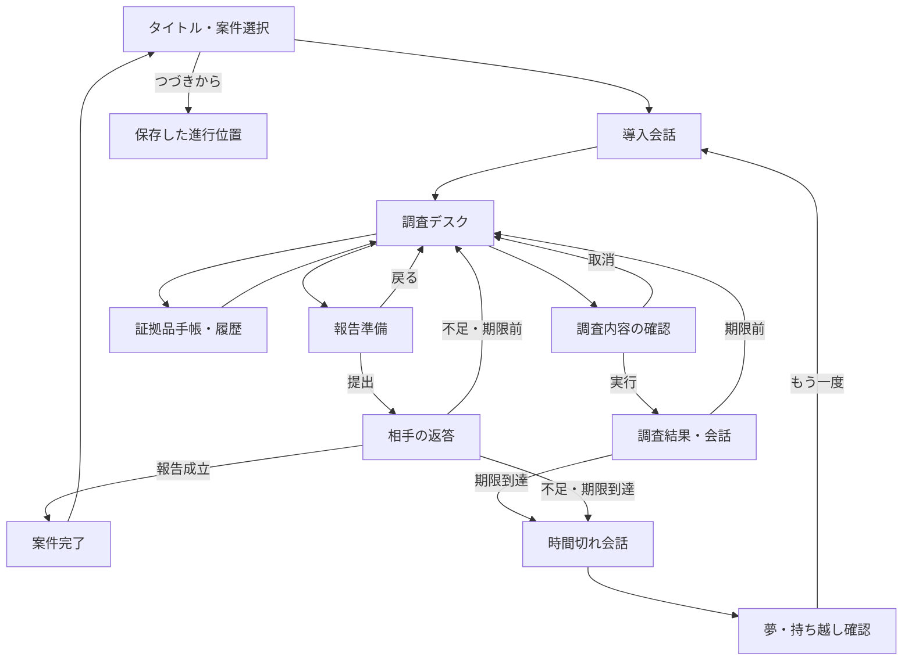

# 調査・報告ドリル「確認して、回答します。」外部設計

## 現行実装への変更

以下は初期設計からの変更点。下記と本文の旧仕様が異なる場合は、編集用原稿とこの変更点を優先する。

- チャンネル名は「#pj-marunage」。作業履歴はロボットアイコンの chatbot による投稿として、人物の投稿と同じ時系列へ流す。
- 報告は3問形式を廃止し、3枚の手がかりで事象・原因・影響と対応を一度に説明する。判定は正解枚数でなく、原稿の elements にある各成立条件を使う。内部の0〜3は表示せず、主人公の説明と佐伯の反応で不足を伝える。提出は毎回10分。成立時のみ案件完了となる。旧セーブの調査記録・手がかりは引き継ぐ。
- 報告画面は会話ウィンドウに佐伯の立ち絵を載せ、上部に選択枠と報告操作、下部に調査と共用の手がかりデッキを置く。

- 第1面は「ウォーターマークの誤表示」。経理の三田が取引先提出用に印刷したPDFに、5年前に退職した田中太郎の透かしが入る。三田の氏名が入る想定との食い違い、透かしの氏名が入る原因の裏付け、影響と是正案を報告する。
- 調査は18件。仕様書から画面・外部・詳細へ、1hのソース解析からバックエンド・フロントエンド・共通処理へ分岐する。PDF生成処理はバックエンド調査後だけ表示する。仕様書は古い概要として対応するソースの読解時間を短縮するが、原因確定には使わない。詳細は[案件設計](problems/01_pdf-incident-design.md)を参照。
- ログとデバッガは何度でも使い、成功後も未着手へ戻す。効果が得られなかった調査も未着手へ戻す。再実行には時間を使い、同じ結果の報酬は重複させない。
- 調査カードのクリックは確認ポップアップなしで実行する。履歴タブは削除し、右の「#pj-marunage」に人物の投稿と作業の記録を日付・時刻順で統合する。状態遷移と単なる列移動を省き、消費時間を背景表示、知識・手がかりなどの増加をアイコン表示する。左の知識欄にも同じアイコンを付ける。会話はその場で開き、再描画後も展開状態と読んでいる位置を保つ。新規の作業記録も未読の対象とする。
- 報告画面は問い・選択枠・提出操作をコンパクトにまとめ、手元の手がかりを縦長カードの横スクロールにする。カード選択後も横スクロール位置を保つ。報告カードも確認ポップアップなしで実行し、消費時間は操作に表示する。
- チャットへの作業記録の追加はイベント終了時。下からスライドして現れ、消費時間・知識・手がかりの増加・時間短縮をその記録にまとめる。イベント中は追加を保留し、その間に到達した人物の投稿も完了時に表示する。右下の変化ポップアップは廃止する。時間短縮の効果弾とカードのハイライトは残す。動きを減らす設定ではスライドを止め、保存から再開した過去の履歴は新着として演出しない。
- 期限前に途中報告していた場合は、未完了時に真壁が一日だけ延長を取りつける。途中報告なし、または延長した2日目も未完了ならゲームオーバー。期限時点で初めて途中報告しても延長しない。
- 翌日は手がかり・知識・調査状況・報告の進み具合を保ち、9:00から専用の会話で再開する。夢から目覚める演出や初日の導入は再生しない。「はじめからやり直す」は日数も含めて新しい試行を開始する。

## 1. 本書の位置づけ

[企画書](00_企画.md)に基づき、プレイヤーに見える画面・操作・進行・結果を定義する。実装済みの仕様ではなく、試作用の設計である。

`25_desgin-block-drill` の案件別データ、会話のスキップ・再読、案件別保存、原稿と実行データの分離を参考にする。ブロック接続、全ケース検証、点数・ランクによる評価は本作に持ち込まない。

企画書で未確定の数値は本書の「試作値」を採用し、プレイ確認後に調整する。学習目的や物語の方針を変更するものではない。

## 2. 対象範囲

ブラウザで遊ぶ1人用の短編アドベンチャー。調査先、質問、証拠品を選択して進める。自由入力による回答や実際のプログラム修正は要求しない。

| 対象 | 今回の設計範囲 |
|---|---|
| 第1面：設計図のウォーターマーク | 導入、調査12件、証拠品8枚、報告3問、会話分岐、時間切れ、周回 |
| 第2〜4面 | 題材と学習テーマを維持した編集用の草案。公開対象にしない |
| おたすけ | コーヒーのみ。その他のカードは拡張候補 |
| 社内チャット・AI | 原稿に基づくゲーム内の演出。外部サービスとの通信はしない |
| 保存 | 同一ブラウザでの自動保存。アカウント・クラウド同期は対象外 |

## 3. 作品の見せ方

表向きは少々おかしなSES会社の日常。案件選択を「試験」、失敗を「不合格」と表示しない。相手の問いに答えられたかを、台詞と案件の結末で返す。

- 主人公：状況を十分に知らないまま依頼を受ける。
- 佐伯：顧客への返答と約束の時刻を気にしている。
- 真壁：自分の仕事を持つ先輩。ヒント係として待機しない。
- 顧客担当者：開発手段より、業務上の困りごとを解決したい。

暗い紺色の背景、控えめなシアン・紫のパネルなど、既存作の雰囲気を参考にする。調査は業務用デスク、会話は人物と台詞、証拠品はメモカードとして見せる。発光・演出より長文の読みやすさを優先する。

## 4. 画面と遷移



### 4.1 タイトル・案件選択

タイトル、短い導入文、「はじめる」「つづきから」「案件を選ぶ」「設定」を表示する。保存がなければ「つづきから」は無効。

初回は第1面のみ選択可能。第2〜4面は「準備中」と表示するか一覧に出さず、開始できない。将来は前案件の完了で次案件を解放する。

「はじめる」は選択案件の今回の進行をやり直す操作とする。保存がある場合は失われる範囲を確認し、完了記録・直感・既読は保持する。「すべての記録を消す」は設定内に分け、確認を必須にする。

### 4.2 会話画面

人物名、立ち絵または代替アイコン、台詞、次へ、スキップ、会話履歴を表示する。心の声は主人公の内心として区別する。

文字送り中の決定で全文表示、全文表示後の決定で次へ進む。スキップはその会話の終端まで進める。獲得物・時間消費・完了処理はスキップしても同じ。既読は会話IDと版で記録する。

導入は周回ごとに再生し、既読スキップが可能。履歴からの再読は状態を変えない。調査結果と返答も履歴に残す。長い説教は初回のみ全文、同一周回での再訪は短文にする。

### 4.3 調査デスク

| 領域 | 内容・操作 |
|---|---|
| 上部 | 案件名、ゲーム内時刻、回答期限、周回数、設定 |
| 左 | 現在の依頼メモ、業務知識、システム知識、直感 |
| 中央 | 調査候補。名称、概要、所要時間、調査済み表示 |
| 右 | 社内チャット。時刻、発言者、本文、未読件数 |
| 下部 | 証拠品手帳、おたすけ、報告する、履歴 |

依頼メモは主人公が聞いた事実を記録する。正解条件や必要カードの一覧を自動表示しない。調査候補が増えたら「新しい調査先」を付け、未解放の候補は表示しない。

調査候補を選ぶと、内容、確定した消費時間、実行後の予定時刻を確認できる。効果や成否は事前に断定しない。「実行」で確定し、「戻る」では時間を消費しない。

実行中は他の調査・報告の確定を受け付けない。結果表示には経過時間、得た情報、獲得証拠品、新しい調査先を示す。何も分からなかった場合も、得た少量の知識は表示する。

### 4.4 証拠品手帳

獲得済みのカードを一覧表示する。詳細は名称、内容、情報源、確認時刻、情報の扱い（確認済み／提案／参考）を持つ。AI案は提案として記録し、現行システムで確認した事実と区別する。

同一カードは重複取得しない。再閲覧、並べ替え、会話履歴の閲覧で時間は進まない。持ち越しの記憶と今回確認した証拠品は別表示とし、未再確認の記憶は提出できない。

### 4.5 報告準備・返答

報告先と相手の問いを表示し、所持証拠品から3枚を選ぶ。第1面は段階的に3問を出し、前の問が成立すると次へ進む。提出順序は評価せず、同じカードを複数枠に置けない。別の問では同じカードを再利用できる。

選択数を「2 / 3枚」のように表示する。3枚未満では提出不可。手帳を開いても選択を保持する。「調査へ戻る」は時間を消費しない。

「この内容で報告する」の確認で10分消費する。各問で相手の問いと選択カードをもとに、主人公の報告文を原稿から組み立てて表示する。自由文の採点は行わない。

不十分な報告では、相手が不足・誤解に応じて返答する。正解カード名や点数は出さない。残り時間があれば、同じ問に再挑戦できる。成立済みの問は同じ周回では再提出不要で、調査へ戻っても保持する。

3問目の成立で案件完了。完了会話、今回の報告、調査・会話履歴を読める。ランク、最短時間、他プレイヤーとの比較は表示しない。

### 4.6 時間切れ・持ち越し

期限に到達して報告が完成していなければ、佐伯からの催促、暗転、夢から覚める会話へ進む。「GAME OVER」は表示しない。

「覚えていること」画面で持ち越す記憶を確認し、「もう一度」で次周回へ進む。自動的に導入へ戻し続けない。タイトルへ戻ることもできる。

## 5. 時間・知識・調査のルール

### 5.1 ゲーム内時間

試作の第1面は09:00開始、17:00期限の480分。読んでいる現実時間では進まない。昼休みも自動で差し引かず、ゲーム上の時間として連続して扱う。

1. 実行前の時刻・知識・所持情報から、結果分岐と所要時間を確定する。
2. 消費時間分だけ時刻を進め、結果・知識・証拠品を一度だけ反映する。
3. 開始時刻より後、終了時刻以下のチャット投稿を時刻順に追加する。
4. 期限到達なら、調査結果を読んだ後に時間切れへ進む。

通常調査の予定終了が期限を超える場合は実行不可とし、「期限までに終わらない」と示す。期限ちょうどで終わる調査は実行できるが、その後の報告時間は残らない。候補選択時にその旨を知らせる。

報告も1回10分。期限を超える提出は不可。最終報告が期限ちょうどに成立した場合は完了を優先する。それ以外の期限到達は時間切れ。残り10分未満で進められない場合も「期限を迎える」を選べる。期限前の早期周回はメニューの「この周回をやり直す」で明示的に確認する。

所要時間が変わる場合は、確認画面で実際の値を表示する。確認中の放置や履歴閲覧は予定を変えない。

### 5.2 知識

業務知識・システム知識は試作値0〜5。調査結果に応じて加算し、上限を超えない。案件開始・周回開始時に0へ戻す。知識は調査結果・調査効率の条件に使い、報告の正解を知識値だけで決めない。

直感は0〜3。新しい記憶を得た周回の終了時に最大1増やす。同じ内容の短い周回を繰り返しても増えない。案件をまたいで維持する。直感0でもすべての必須証拠品を通常調査で取得できる。

### 5.3 解放・再調査

調査先は最初から表示する候補と、証拠品・調査結果によって解放する候補を持つ。解放した調査先は同じ周回中は閉じない。

一度実行した調査は「結果を読む」として時間なしで再読できる。知識や情報が変わって結果が変わる調査のみ「再調査」を出し、改めて所定時間を消費する。同じ条件で知識・証拠品を繰り返し獲得できない。

試作は結果を固定条件で分岐させ、乱数を使わない。遠回りの候補にも資料や会話を用意し、単に外れボタンとして扱わない。

## 6. 社内チャットと真壁への質問

チャットは時刻に紐づく固定投稿。09:00時点の投稿は開始時に表示する。長い調査後には複数件がまとめて増え、1行動1投稿にはしない。最新位置を読んでいるときだけ自動スクロールし、過去ログ閲覧中は未読表示を出す。保存復元で投稿を重複させない。

真壁の対応状況は調査開始時刻で判定する。数値ゲージや「今が質問チャンス」といった正解表示はしない。予定の境界は開始を含み終了を含まない。

| 時刻 | 内部の対応状況 | 質問時の基本反応 |
|---|---|---|
| 09:00〜10:30 | 障害対応中 | 忙しい。初回は説教になる場合がある |
| 10:30〜10:45 | 作業中 | 短い返答 |
| 10:45〜11:15 | ひと段落 | 具体的な質問なら調査先を教える |
| 11:15〜12:00 | 関連作業中 | 具体的な質問に短く答える |
| 12:00〜13:00 | 作業中 | 短い返答 |
| 13:00〜14:00 | 会議中 | 不在。長い説教は発生しない |
| 14:00〜17:00 | 作業中 | 質問の準備状況に応じて返答 |

質問候補は発見済み情報に応じて増える。確認画面では会話の所要時間（10〜45分）を表示する。適切な質問の初回は短く有益、曖昧な質問は成果なし。同一周回で説教を繰り返さない。

真壁経由で得られる必須情報は、資料とソース調査でも取得できる。質問回数は独立管理し、試作では上限を設けない。実行済みと同じ条件での質問は無料再読にする。

## 7. おたすけとひらめき

試作は所持枠1、コーヒー1枚、周回ごとに1回。使用に5分消費する。確認画面で残り回数・消費時間を示す。

手持ちの証拠品に関係する独白を返す。情報が足りなければ「……うまい」で終わる。直感が高い場合は具体的な独白に変わるが、新しい事実や未取得の証拠品を生成しない。必須の調査先の唯一の解放条件にしない。

お菓子・仮眠・散歩、連続使用による減衰や失敗率は将来の試作対象とし、初期画面には出さない。

## 8. 報告判定

判定対象はその時点の3枚の集合。カードの位置や選択順には依存しない。作者向けの条件は問題原稿に置き、プレイヤーには公開しない。

判定順序は「明確な誤解への返答 → 成立する組み合わせ → 情報不足の返答」。複数条件が一致する場合は原稿内の先頭を採用する。条件と返答は必ず対応づける。成立する組み合わせは複数登録できる。

第1面では、目的と対象、方式と既存構造、顧客に伝える効果と限界を別々の問いにする。3枚を当てるだけにならないよう、カード本文に情報源と意味を記載し、各返答で相手が何を気にしているかを示す。

「利用者を識別できる情報がある」ことを「実際に流出させた本人を確定できる」に置き換えない。画面だけのCSS透かしをPDFへの埋め込みとして扱わない。これらは架空の案件内の仕様・事実として出題する。

## 9. 周回・案件進行・保存

### 9.1 持ち越し

第1面の持ち越しは、獲得済みの「用語」「対象範囲」「システム構造」の記憶を各1件、最大3件。対象カードIDを問題側で指定する。全自動で対象を選び、選択の手間を増やさない。

記憶がある調査には「前にも調べた気がする」と表示し、再取得の時間を短縮する。今回の証拠品は再調査してから取得する。周回開始時は時刻、知識、所持証拠品、報告進捗、質問履歴、おたすけ回数、チャットを初期化する。記憶、直感、既読、案件完了記録は保持する。

### 9.2 自動保存

調査確定後、報告確定後、会話の進行、周回開始、案件完了、設定変更を自動保存する。確定した効果と表示中の会話位置を一緒に保存し、再開時に時間・知識・証拠品を二重反映しない。

| 保存の単位 | 内容 |
|---|---|
| 全体 | 保存形式の版、直感、成長済み記憶ID、案件完了、既読、設定 |
| 案件 | 原稿の版、周回数、記憶、過去の調査・報告履歴 |
| 現在の周回 | 時刻、知識、証拠品、解放先、調査結果、報告の位置・選択、投稿位置、会話位置、使用済みカード |

保存不能でも現在のタブでは進行する。「このブラウザには保存できません。閉じると今回の続きが失われます」と表示する。破損データは勝手に上書きせず、再開始を案内する。

原稿の版が変わり進行を安全に復元できない場合は、当該案件の周回を再開始する旨を表示して確認する。安定したIDの完了記録・既読・記憶は維持し、消えたIDは参照しない。

## 10. 操作・表示品質

PCでは調査とチャットを同時表示する。目安として幅1100px以上を3列、700〜1099pxを2列、700px未満を1列とし、狭い画面ではチャット・手帳をタブで切り替える。切替中も時刻と報告への導線を保つ。文書全体の横スクロールは生じさせない。

クリック・タップに加え、Tab、Enter、Spaceで操作可能にする。Escapeは確認画面・手帳を閉じる操作とし、調査の取消や周回リセットを誤発火させない。ドラッグ操作は必須にしない。

確認画面はフォーカスを内部に移し、閉じたら元の操作へ戻す。カードの選択状態、調査済み、未読は文字でも示す。新着投稿を読み上げで一斉に割り込ませない。

設定に文字送り速度、即時全文表示、動きを減らすを用意する。暗転・スライドは短くし、減速設定では省略する。原稿はテキストとして表示し、任意HTML・スクリプトを実行しない。

## 11. 編集用原稿とデータへの組み込み

```text
docs/
  00_企画.md
  10_外部設計.md
  scenarios/
    README.md
    01_watermark.md         # 台詞、チャット、人物予定
    02_approval-button.md   # 以下3面は草案
    03_bulk-import.md
    04_closing-automation.md
  problems/
    README.md
    01_watermark.md         # 調査、証拠品、報告、記憶
    02_approval-button.md
    03_bulk-import.md
    04_closing-automation.md
```

第1面のMarkdownを編集の正本とし、node scripts/build-content.mjs で同じフォルダのJSONを生成する。台詞はシナリオ原稿、条件・数値・カード本文は問題原稿に分ける。両者は `caseId` と会話IDで関連づける。表示名やファイル名を判定キーにしない。

ビルド処理でJSONを検証し、`src/data/content.mjs` へ取り込む。生成物を別途手編集しない。第1面のプロトタイプは `src/index.html`、進行処理は `src/engine.mjs`、画面は `src/app.mjs` に実装した。起動・検証方法は [README](../README.md) を参照。

編集方法・条件表現は各フォルダのREADMEに定義する。第2〜4面は未確定部分を含むため、JSONへの変換とレビューを終えるまでビルド対象に含めない。

組み込み時は、重複ID、未知の会話・カード参照、不正な時刻、欠落した既定分岐、3枚で満たせない成立条件、必須証拠品に到達できない状態を検出する。原稿の誤りがあればその案件を開始させず、案件名とエラーを開発時に表示する。

## 12. 第1面の確認観点

| 観点 | 期待する挙動 |
|---|---|
| 正常進行 | 真壁・コーヒー・直感に頼らず、初周で3問の報告を完了できる |
| 遠回り | 知識不足のソース調査は時間を消費し、後の準備で再調査が可能になる |
| 目的の取り違え | CSS案だけでPDFの流出対策を報告すると、自然な問い返しになる |
| 報告不足 | 不足に対応する返答になり、調査後に同じ問を再提出できる |
| チャット | 2時間経過時に期間内の複数投稿が順序どおり現れる |
| 真壁 | 同じ質問でも開始時刻と準備状況で変わる。会議中と説教を区別する |
| コーヒー | 情報なしでは事実を得られず、情報ありでは関連を示す |
| 期限境界 | 期限ちょうどの最終報告成立を完了とし、それ以外は時間切れにする |
| 周回 | 最大3件の記憶と直感を保持し、今回の証拠品は再確認する |
| 二重操作 | 連打、再読、保存復元で時間消費・獲得・完了を重複させない |
| 再開 | 結果会話の途中から復元でき、効果を二重反映しない |
| 表示 | 狭い画面・キーボード・演出省略でも調査と報告ができる |

作者用の成立経路例：用語5分 → 目的確認30分 → 対象確認30分 → 現行設計書120分 → 利用者情報30分 → ソース解析90分 → PDF検証60分 → 報告3回30分。計395分、15:35完了。最短ルートとして画面には出さない。

## 13. 試作で調整する項目

| 項目 | 今回の試作値・方針 | 確認すること |
|---|---|---|
| ゲーム内の制限 | 480分 | 初周から複数の進め方で完了できるか |
| 現実の所要時間 | 未確定 | 台詞・資料を普通に読んだときの長さ |
| 知識・直感 | 知識0〜5、直感0〜3 | 数値が正解誘導になりすぎないか |
| 持ち越し | 最大3件の再確認短縮 | 同じ作業の負担を減らせるか |
| 報告 | 3問、各3枚、各10分 | カード総当たりより意味を考えられるか |
| おたすけ | コーヒー1回、5分 | 必須攻略手段にならず会話を楽しめるか |
| チャット・説教 | 固定投稿、長文説教は周回内1回 | 職場の空気を出し、再挑戦を妨げないか |

第2〜4面の正式な要件、その他のおたすけ、公開先・配布形式、画像・音素材は後続設計で決める。

