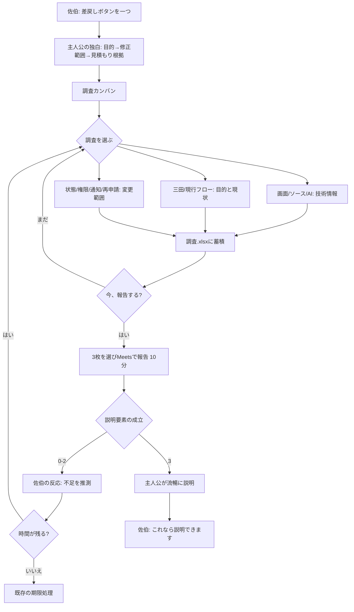
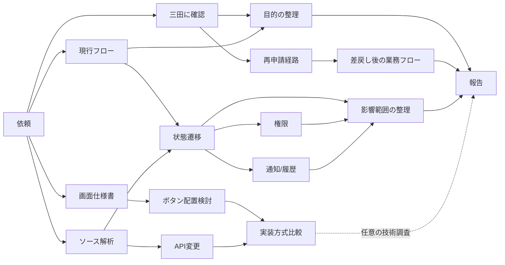

# 第2面フロー

## 全体

## 調査依存関係

## 代表的なプレイ経路
### A: 第1面の成功体験をそのまま繰り返す
画面仕様→ソース→API→ボタン配置→AI案→報告。
得られる知識は多いが目的・業務フローが不足。佐伯は「担当者には何と説明する？」と返す。
**技術調査をしたこと自体は否定しない。**

### B: 業務だけ見て早期報告
三田→現行フロー→再申請経路→報告。
目的とフローは分かるが状態/権限等の影響を把握していない。
佐伯「ボタン一つで済むんでしょうか？」。調査へ戻る。

### C: 適切に切り上げる
三田→現行フロー→再申請経路→状態遷移→権限（または通知）→報告。
目的・フロー・影響が揃い、なぜボタン一個分の見積もりでは済まないかを説明できれば、工数未確定でも成功。実装方式の比較は不要。

### D: 全部調べる
全調査を実行する。技術知識も増えるが時間を使い切る危険。
禁止せず、期限と会話で結果を返す。調査完了率の減点表示はしない。

## 途中報告
現行の「真壁に途中報告」は最終報告とは別のコマンド。第2面も同じ導線で、未解決でも途中報告を受け付ける。
期限時の延長分岐は現行仕様に合わせる。第2面で新たに夢オチを実装する場合は別チケットにする。
