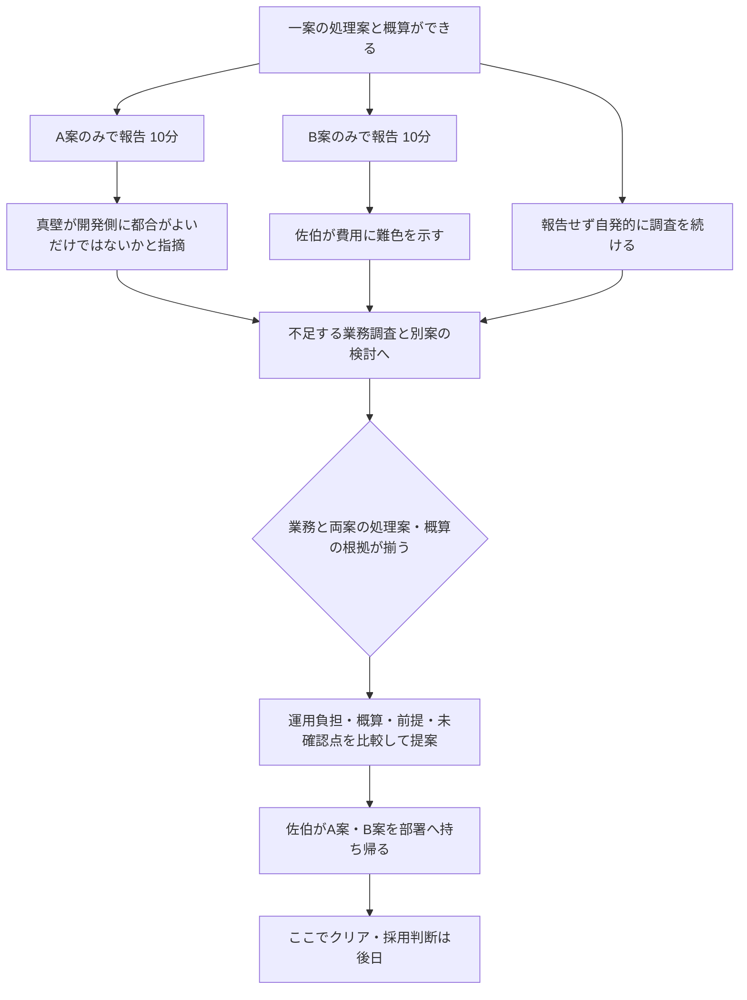

# 第3章「一括登録機能」仕様

> **状態：再設計をゲームへ反映済み。** 問題・会話の編集正本は docs/problems と docs/scenarios。調査の構造と背景は本分冊を参照する。

背景は [background.md](background.md)、調査の条件・時間・経路は [20_フロー.md](20_フロー.md)。ここでは体験の方針と報告の成立条件を扱う。

## 1. 何を起点に作り直すか

プレイヤーが引き受けた仕事は、毎朝の手入力を減らすための調査と見積もり。最初に分かるのは一括登録の依頼だけで、CSVは主人公が思い付いた取込方法の候補とする。

現行案では、ソース調査で「途中失敗」「関連データ」「通知」が一斉に解放され、その後にA案・B案を見積もる構造になっている。また、実物のExcelに進むために佐伯への聞き取りを必須にしている。このため、発見より先に調査の結論が提示され、業務側から進む順序に寄りやすい。

第1章から引き継ぐのは、次の構造。

| 第1章で自然だったこと | 第3章での使い方 |
|---|---|
| 現物・資料・ソースなど複数の大きな入口がある | 業務・Excel・画面・ソース・資料・真壁から始められる |
| ログや現物で対象が絞れると、次の調査に理由ができる | 試した登録や届いた通知を手がかりに、追跡先が見つかる |
| 準備によって同じ道具で得られる結果が変わる | 正常登録の追跡と、失敗後・再送後の追跡では確認内容が変わる |
| 資料が対応するコードの読解時間を短縮する | 全体を先に読む経路と、試行結果から必要箇所だけ読む経路を両立させる |
| 真壁に聞かなくても、実物と実行結果で裏付けられる | マクロ案や先輩の経験談を聞かなくても、範囲確認と方式比較に届く |

第1章資料の報告形式やチケット自動移動など、後から変更された旧ルールは復活させない。

### 入口の自由と、比較に必要な情報は分ける

「業務から始める」「ソースから始める」は、どちらか一方だけで完結する別問題ではない。**業務上の負担・範囲と、技術的な実現性・工数の両方が揃って初めて、顧客が選べる比較になる。** 入口と調査順は自由にし、最後には両方の視点が合流する。

途中で一案の概算を出し、これで報告できると思う状態も認める。その時点で報告すれば、A案だけなら真壁が開発側の都合に偏っていないかを指摘し、B案だけなら佐伯が費用の大きさに難色を示す。どちらも調査を続けるきっかけであり、誤った案を引いたという扱いにはしない。

### プレイヤーに見せる順序

**手元の仕事を試す → 予想と違う結果を見る → その結果を追う → 直し方を考える → 残る仕事を担当と確かめる → 作業量を見積もる。**

A案・B案は設計者が到達点を確認するための呼び名。初期チケット名・導入・初回相談には出さない。最初から「失敗時の扱い」「再投入の重複防止」を課題として並べない。

## 2. 報告に進む条件

### 報告によって足りない視点に気づく流れ

この指摘を聞くこと自体は必須条件にしない。一案を見積もった後、プレイヤーがそのまま業務・別案の調査を続ければ、自力で比較提案に至る。

### 2.1 いつでも報告の場へ進める

Meetsタブは最初から開ける。資料が揃っていないことを理由に、報告の場への入場を禁止しない。3枚選択・提出10分は維持し、十分な材料がなくても現時点の説明を試せる。

まだCSVを読めるという話だけ、片方の方式だけ、現場の作業が抜けた話などでは完了しない。この段階では未消化の調査・検討チケットが残っており、報告後にカンバンへ戻って必要なところを続けられる。報告を理由に、それらを完了扱いや選択不能にしない。

**「戻れる」だけでなく、「何がまだ分かっていないから戻るのか」が分かる反応にする。** 真壁・佐伯は、やり直す担当者の手間、CSVを誰が整えるか、より簡単な方法の有無など、欠けている視点を指摘する。正解のチケットIDや順番を列挙せず、指摘内容を会話履歴に残し、プレイヤーが残っている行動と結び付けられるようにする。

| 報告で残った疑問 | カンバンに残る／派生する調査・検討 |
|---|---|
| 担当は毎回全部入れ直して困らないのか | 未消化の担当者確認、M2・M3。既に担当と話した場合も、失敗後の作業という追加確認を選べる |
| 10日かけずに作れる方法はないのか | まだ検討していない取消単位・通知時点の確認、R1の別案検討、R2の概算更新 |
| 届いたExcelをそのまま使えるのか | 未消化のI2・M1・M2。準備担当と今回の範囲を確かめる |
| どこまで確認した数字なのか | 根拠が不足する既存処理の調査へ戻るか、詳細設計・試験の未完了を明示して概算として整理する |

既に確認した事実を忘れたことにはしない。新しい疑問なら追加確認・再検討として扱い、完了カードのクリックで無条件に再実行させない。残るチケットが完成版の詳細設計や全パターン試験だけになった場合は、全て終えないと報告できないとはしない。比較に必要な判断材料が揃ったかで切り上げる。

顧客からその場で得た新しい業務情報がある場合は、その情報だけを記録する。会議に出ただけで未調査の技術証拠を埋めない。

| 報告時点の状態 | 反応する人物と意図 | 調査へ戻る方向 |
|---|---|---|
| A案1日だけを提示し、これでできると報告 | **真壁**が、作りやすさだけで決めていないか、担当が毎回やり直す負担を把握しているかを問う | 現場の作業・失敗後の運用が不足ならM2・M3へ。正常行を残す別案を未検討ならD3・R1・R2へ |
| B案10日だけを提示し、これでできると報告 | **佐伯**が、依頼の規模に対して高いのではないか、もっと簡単な方法はないかと難色を示す | 全体取消の方法をR1で検討し、R2で見積もる。現場の負担や今回の範囲が不足ならM2・M3も確認する |
| 技術上の1日／10日はあるが、業務の負担・準備担当が不明 | 佐伯が、担当者の作業がどう変わるのか判断できない | M2・M3で比較に必要な業務情報を得る |
| 両案の根拠・業務への影響・概算の留保を示し、検討を依頼 | 佐伯がA案・B案を利用部署へ持ち帰る | ここでクリア。採用判断や詳細見積もりは後の仕事 |

真壁のA案への指摘は、別途「真壁に相談する」を必須にせず、既存Meetsの報告イベントで同席者として行う。通常の個別相談の予定判定とは区別し、短い指摘の後もプレイヤーが次の調査を選ぶ。B案への難色も、10日が技術的に誤りという意味ではない。**A案の開発上の都合、B案の業務上の便利さの片方だけでは、採用の根拠が足りない**という反応にする。

両案をすでに調べていても、一方だけを提示して採用を決めつければ同じ反応になる。所持情報が揃うことと、比較して提案することを分ける。反応を受けて自動で別案の証拠や見積もりを与えることはしない。

### 2.2 最終報告を成立させる内容

| 要素 | 裏付ける内容 | 不十分な例 |
|---|---|---|
| 業務と共通範囲 | 転記を減らすこと、CSVの準備・補正を誰が行うか、自動変換やマクロ新規開発を含めないこと | Excelをそのまま渡せば自動で全部直ると思われたまま |
| 全体取消の候補 | 所定CSVを前提に1日程度の概算。エラーなら全件取消、修正後は全件再投入という設計案。結果が単純で早く導入できる見通し | 完成版で動作確認済み・確約済みと受け取らせたり、やり直す仕事を説明しなかったりする |
| 部分成功の候補 | 同じ前提で10日程度の概算。正常行を残して失敗行を返す設計案。関連更新・通知・再送対策の作業と、利用者の運用が増える | 詳細設計・試験の未完了を隠したり、便利そうという印象だけで採用宣言したりする |
| 概算の確度 | 調べた既存処理、検証用コードで試した範囲、未設計部分を区別。今は大きな作業を粗く積んでおり、詳細を詰めた後に変わり得る | 一日で新機能の詳細設計や全パターン検証まで済んだことにする |
| 判断の依頼 | 運用負担と費用の違いを示し、採用を利用部署・佐伯側の判断に返す | 自分や真壁の好みでA/Bのどちらかを決定する |

**佐伯がA案・B案の比較と概算の前提を理解し、利用部署で検討するために持ち帰るところでクリア。** この章の中でA/Bを採用決定させず、返答待ち・詳細設計・正式な見積もりの精査は後の仕事として残す。プレイヤーが顧客の代わりに選ぶ必要はなく、細部まで調査し切る必要もない。

既存の3枚UIに合わせ、E7＋E8を業務・範囲の一枚に整理し、E14・E15を両候補の概算一枚ずつにする構成で実装する。業務の確認事項と、新規の処理案・概算・留保をまとめるもので、未実装の機能を検証済みにする証拠や「顧客に相談するのが正解」という証拠ではない。3枚のうち二枚は両案の概算、もう一枚は業務・範囲・運用のまとめとする。現在の詳細カードは個々の観測を示し、一枚だけで概算や業務全体を代替しない。採用宣言カードは作らず、比較して持ち帰りを依頼する会話に対応させる。

R3や真壁相談をしなくても必要な材料は整理できる。報告の失敗後も手がかりを失わず、調査・再報告を続けられる。

## 3. 既存ゲームから維持するルール

- 9:00〜18:00、昼休憩60分。机上で考えている間は実時間5分でゲーム内1時間が進み、会話・会議・チケット一覧・演出中は止まる。
- 実行後のチケットは作業中に残り、完了への移動は手動。完了カードはクリックしても実行しない。
- 一案ができても調査は閉じない。不足に気づいたら未消化の行動・追加確認・再検討に戻れる。
- Meetsの3枚報告と提出10分を維持。情報が足りない段階でも入場できる。
- 真壁への途中報告は30分、初日の期限延長は従来の条件を維持。顧客への比較報告とは分ける。
- 初回の休憩や初回調査に再実行用の独白を付けない。同じ作業でも、新しい疑問・材料があれば追加確認として意味を持たせる。
- チャットを読んだことや、真壁に指摘されたことをクリア条件にしない。未読通知は全章共通の扱いを維持する。
