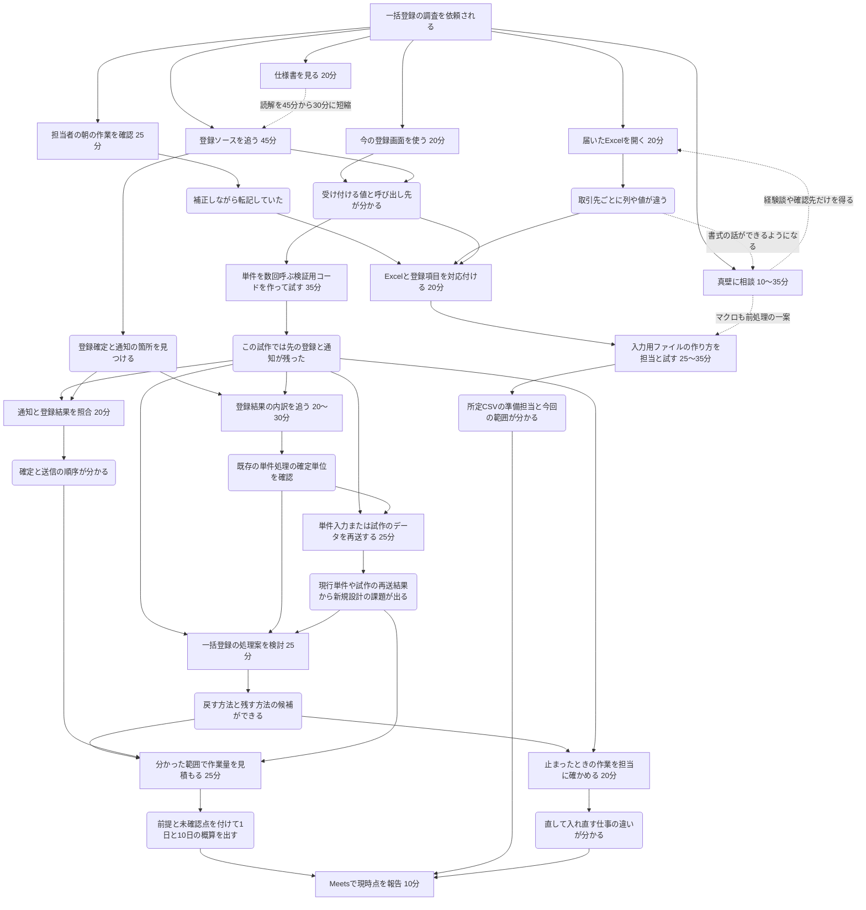
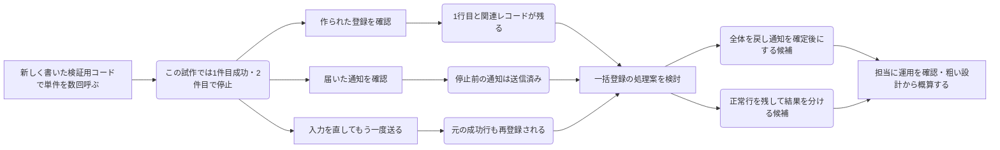

# 第3章「一括登録機能」調査フロー

> **状態：再設計をゲームへ反映済み。** 問題・会話の編集正本は docs/problems と docs/scenarios。調査の構造と背景は本分冊を参照する。

要求とシステムの境界は [background.md](background.md)、報告・クリア条件は [10_第3章仕様.md](10_第3章仕様.md)。本書は行動・発見・派生・時間・経路ごとの確認点を扱う。旧合冊8章の経路は、本書4節（4-1〜4-7）へ移した。

## 1. 初期状態と調査の全体像

### 1.1 最初から選べる行動

| ID | 画面に出す行動 | 時間 | 最初から選べる理由 |
|---|---|---:|---|
| I0 | 依頼を読み直す | 5分 | 依頼メモがある。再読は任意 |
| I1 | 担当者の朝の作業を確認する | 25分 | 佐伯に連絡を取り次いでもらうことはできる。事前の聞き取りチケットを要求しない |
| I2 | 届いたExcelを開く | 20分 | 依頼にサンプル1件を添付する設計。列や値を見られるが、毎日の件数や補正の意図までは確定しない |
| I3 | 今の登録画面を使ってみる | 20分 | 検証環境と操作用の正常サンプルがある |
| I4 | 今の登録処理をソースから追う | 45分 | リポジトリと既存テストを参照できる |
| I5 | 登録まわりの仕様書を見る | 20分 | 既存資料を読む。現行との一致は別確認 |
| K | 真壁に相談する | 10〜35分 | 最初から聞けるが、答えと成果は相談内容・予定次第 |

昼休憩60分、コーヒー5分、真壁への途中報告30分、Meetsへの移動も最初から使える。仕事の調査対象とは分けて扱う。

### 1.2 入口から発見へのフローチャート

長方形は選べる行動、丸角は発見。破線は助言・短縮・別の入口を示し、必須通過点ではない。**複数の矢印が入ることをAND条件とは解釈しない。解放条件は本書2節の表を正本とする。**

図の要点は、**既存の単件処理をどう使うか考え、小さな試作の結果やコードの構造から、新しい一括処理の設計課題を見つけること**。CSV整形の話も、受け取ったExcelと登録側の入力の違いから生まれる。

### 1.3 試行後の分岐を拡大する

正常・不正データを試すこと自体は、CSV取込を実現しようとする通常の検証に含める。検証環境・メール受信箱は調査用とし、本番登録や実際の取引先への通知は行わない。初回でA/Bの方式名や1日／10日までは分からない。

直し方の図は、検討を続けると到達できる候補を示す。一回の検討で両候補が必ず手に入るという意味ではない。片方だけを考えて報告する場合と、別案まで調べ続けて比較する場合を分ける。

## 2. 各調査行動の内容・時間・発見・派生

以下のIDと証拠記号は設計案内の参照用。実装の bi.* への対応と、処理案を選ぶ操作は [30_実装指示.md](30_実装指示.md) に記載する。

### 2.1 業務と入力を調べる

| ID・行動 | 選択可能になる条件 | 時間 | 得られる情報・証拠 | 新たに選べる行動・残る疑問 |
|---|---|---:|---|---|
| I0 依頼を読み直す | 初期 | 5分 | E0：手入力削減の依頼。Excel自動変換までの約束はない | 調査対象を思い出す。特定ルートの必須条件にはしない |
| I1 担当者の朝の作業を確認 | 初期 | 25分 | E1：20〜30件／月初50件、約6項目、人手の補正と転記。日常の手順として確認 | M1、条件が揃えばM2。マクロ等の相談が具体的になる |
| I2 届いたExcelを開く | 初期 | 20分 | E2：実際の列順・全角数字・日付表記。別書式の存在は添付や作業メモから分かる | M1、書式を話題にしたK。誰がどこを直すかはまだ未確認 |
| I3 今の登録画面を使う | 初期 | 20分 | E3：正常な1件の入力・検証、送信内容と呼び出し先、登録完了・通知の現物 | P1、D1、D2、M1。DB内部の仕組みまでは分からない |
| I4 登録ソースを追う | 初期 | 45分。I5後は30分 | E4：入力項目、呼び出し可能な処理、登録確定・関連更新・通知の箇所、追跡用テストデータ | P1、D1、D2、M1。異常時の実行結果は別に確認する |
| I5 仕様書を見る | 初期 | 20分 | E5：想定されていた入力と処理の概要。現行未照合の参考情報 | I4を短縮する。これだけで結果の正しさを確定しない |
| M1 Excelと登録項目を対応付ける | Excel側の内容が分かる（I1またはI2）かつ登録側の入力が分かる（I3またはI4） | 20分 | E6：そのまま送れない列・値と、所定CSVに直せば受け取れる範囲。サンプルで確認する | M2。前処理を人がするか、仕組みを用意するかが初めて具体的な相談になる |
| M2 入力用ファイルの作り方を担当と試す | E6がある。Kでマクロ案を聞いただけでは不可 | I1済み25分／担当に初めて確認する場合35分 | E7：実際の準備作業と担当部署が所定CSVを用意する合意。既存マクロの有無も確認するが、存在を勝手に確定しない | 所定CSV取込の見積もりを今回の範囲に適用できる。自動変換・マクロ新規開発は別途見積もりに分ける |
| M3 止まったときの作業を担当に確かめる | P1の試作結果、または単件処理の調査から作ったR1の設計案がある | 20分 | E8：これから作る機能について、全体を入れ直す場合と失敗行だけ直す場合の仕事を、担当者の現在の手順に照らして確認 | 説明・報告の材料になる。未実装の画面を使った実績や、部署の採用決定にはしない |

I2だけでは正確な日常件数を確定しない。I1を通らない場合、M2の35分の中で担当者から件数と補正の実態も確認する。**同じ事実のためにI1とM2の両方を必須にしない。**

M2で確かめるのは、CSVを用意する実際の仕事と、今回提示する見積もりの共通条件。人手での前処理を将来も続けるという発注決定まで済んだことにはしない。自動変換の希望が強ければ、その希望も未決事項として残し、所定CSVを受け取るA/B比較とは別の追加範囲として報告できる。

### 2.2 実現方法を試し、予想外の結果を追う

| ID・行動 | 選択可能になる条件 | 時間 | 得られる情報・証拠 | 新たに選べる行動・残る疑問 |
|---|---|---:|---|---|
| P1 単件処理を数回呼ぶ検証用コードを作る | E3またはE4。使える入力例と呼び出し先が分かる | 35分 | E9：新しく作った薄い呼び出しコードで正常・不正入力を試した結果。先の呼び出し分が残ることがある。CSV取込や取消・再投入の完成版はまだ作らない | D1、D2、D3、R1、M3。この単純な呼び方を製品にするなら何を設計し直すか |
| D1 単件登録と関連更新の境界を追う | 登録ID・処理箇所を特定できる（E3、E4、E9のいずれか） | 30分。I4済み20分 | E10：既存の単件処理の確定単位・関連更新と、変更が及ぶ箇所。P1済みなら試作結果と照合。未試作なら単件のコード・テストから一括化時の境界を検討する | D3、R1、M3。試作なしの経路では、新規一括処理の失敗後の結果を実測済みとしない |
| D2 通知と登録結果を照合する | 送信・通知を特定できる（E3、E4、E9のいずれか） | 20分 | E11：既存の単件処理の確定と送信の順序。P1があればその試作の送信記録も照合。全件取消案で通知をどこへ移すかは、これからの設計事項 | R1、R2。送信済みメールはDBの取消で戻らず、単件の流用だけでは済まないと分かる |
| D3 同じデータをもう一度送る | P1の試作結果、またはD1の単件処理の確定単位が分かる | 25分 | E12：既存の単件入力、またはP1の検証用コードへ同じデータを再送した結果。新規のCSV再投入について、行識別・結果記録・通知重複対策が必要になりそうだと分かる | R1、R2、M3。確認した再送結果と、未実装の一括機能の設計課題を区別する |
| R1 一括登録の処理案を検討する | E9の試作結果、またはE10の単件処理の構造が分かる | 初回25分／新しい視点を得た後の再検討15分 | E13：既存部分をどう流用し、何を新設するかの設計案。全体取消か正常行を残す方法の片方からでもよい。詳細な画面・全例外・試験仕様は未完了 | R2、M3。詳細設計へ進み始めるが、時間内でどこまで詰めるかを判断する |
| R2 分かった範囲で概算を出す | R1で検討した候補がある | 初回25分／新情報・追加案の反映15分 | **検討した案だけ**を粗く積む。E10・E11を根拠にA案は1日程度、E10・E11・E12を根拠にB案は10日程度を目安にする。前提・未設計部分・追加確認を付ける。未検討の別案を自動生成しない | 概算E14・E15を得る。業務・範囲・運用負担が不足していれば調査へ戻るが、完成版の実装・詳細設計の全消化までは要求しない |
| R3 担当への説明を組み立てる | 任意の調査結果がある | 15分・任意 | 手元の事実と未確認点を整理するだけ。所持していない事実・工数・合意を生成しない | 報告用に証拠を束ねられる。R3の実行フラグをクリア条件にしない |

P1は新しく書いた検証用コードの実測、D1は既存単件処理の構造の確認。両方とも一括化の設計課題と概算に進む手がかりになるが、得た情報の確度は同じではない。D1だけで進む場合は未試作という留保を付け、P1を必須にしない。P1から入った場合も、I4で全体を読むことを必須にせずD1で必要箇所を追えばよい。

### 2.3 準備で結果が変わる調査の扱い

- D1・D2を正常な単件登録だけで先に使った場合も、その一件の確定単位や送信の仕組みを確認できる。未実装の一括機能の異常経路まで確認したことにはしない。
- D2で失敗後の記録をまだ確認していない場合は、部分停止の発見後に「追加で照合する」が可能。追加確認は10分で、前の20分を無効にはしない。追加の事実を得ない同じ照合は通常20分。
- 同じ対象を実際に照合して得た情報は、実行順で価値を変えない。ただし、既存単件の事実・P1の試作結果・新規機能への推測という区別は保持する。
- R2の不足は、未確認の通知タイミングなど、実際の疑問として残す。先輩相談済み・指定順でのチケット消化済みなどを価格の根拠にしない。追加情報を得た後の見積もり更新は15分。新情報なしで同じ検討を繰り返しても工数は変わらない。
- 一度得た証拠は、別ルートを選び直しても失わない。同じ結果の報酬は重複させない。初回の休憩や初回の空振りに「さっきも見た」という再実行用の独白を付けない。

### 2.4 解放条件を事実として扱う

| 必要な状態 | 到達できる経路 |
|---|---|
| 登録を呼べる | I3の送信内容確認 **または** I4のコード・既存テスト確認 |
| 一括化の確定・取消の設計を考えられる | P1で検証用コードの挙動を見る **または** D1で既存単件の確定単位を調べる。後者は新規一括処理の実測ではない |
| Excelと入力側の差が分かる | I1またはI2で得た実データと、I3またはI4の入力情報をM1で対応付ける |
| 担当の運用・件数が分かる | I1 **または** M2で初めて担当者に確認する35分の経路 |
| 再投入の設計課題に気づく | P1または既存単件への再送をD3で確かめ、新規機能に必要な制御を検討する |
| 一案の概算を出せる | 既存処理の流用箇所と新規作業の見通しがあり、未確認の設計・試験も挙げられる。もう一案まで分かったことにはしない |
| 顧客が持ち帰れる比較ができる | **業務・準備担当・運用負担と、両案の処理案・概算・前提・未確認点が揃う。** 真壁相談、片案での報告、詳細設計の完了は必要条件にしない |

依存関係は、呼び出し先も分からないのに試行できない、といった仕事上の理由に限る。後の実装では同等の証拠を受け入れ、特定のチケットIDを通ったというだけの隠れた必須フラグを作らない。

## 3. 寄り道と行き詰まり

| 行動・誤解 | 現実的な意味／起きること | 戻れるきっかけ |
|---|---|---|
| CSVライブラリ比較（任意40分） | 読取形式・保守性・検証のしやすさを確認できる。実装手段を考え始めたI3/I4後に解放 | 読めることと、登録途中で止まった後の扱いが別だと試行で分かる |
| 大量処理の構成を検討（任意60分） | 処理件数や性能の仮説を立てる。I4またはP1後に選べる | 実際の20〜30件／50件と照合し、今回の優先度を判断する。調査前から無意味と断定しない |
| 他部署の集計を追う（任意45分） | I4/D1で参照先を見つけてから追跡。変更範囲の除外に根拠ができる | 今回更新されない証拠を得て切り上げる。残りの処理全体を安心と断定しない |
| マクロを作れば終わると思う | M1/K後にマクロ案の適用範囲を確かめる調査（任意25分）は可能。道具としての利点・保守・誤変換の課題が分かる | 登録・通知・再送の挙動は別に残る。新規開発は今回の1日／10日から切り離す |
| Excelを開けば業務が分かったと思う | 列と値は分かるが、補正の意図や朝の仕事全体は分からない | M2で担当が準備を試す際に、実際に残る作業を確認する |
| 一件登録を反復すれば終わると思う | 小さい試作は合理的な初手で、呼び出せることも確かめられる | 止まった後の登録・関連データ・通知を実物で見る |
| 途中で止まれば全部戻ると思う | DBとメールを同じ取消可能な結果だと思い込む | D1/D2の記録を突き合わせる |
| 同じファイルを送り直せばよいと思う | 修正して再送する行動自体は自然 | D3で登録・通知の重複を観測する |
| 詳細設計を終えるまで見積もりを出せないと思う | 例外や画面・再投入手順を詰めるほど時間を使う。今回の期限内に全ての設計・検証は終わらない | 大きな作業差と業務負担が分かれば、前提と未確認点を付けた概算として比較する。残る設計チケットは消化し切らない |
| 佐伯の件数や真壁のマクロ案を確定事実にする | 人物の伝聞・経験と、今回の現物を混同する | 担当実績や実際の準備作業との相違で、情報の確度を見直す |

寄り道の発見は証拠として残す。正解に使わないという理由で「何も分からなかった」とはしない。採用しないことや対象外とすることにも、仕事上の根拠がある。

既に確認済みの対象を、新しい仮説も記録もなく繰り返した場合だけ時間を消費して新情報なしとする。同じ行動でも異なる状況の確認ができる場合は、再調査の価値を残す。

## 4. 最終報告へ至る複数の経路

次は到達可能性を確かめるための例で、推奨手順や必須順序としてゲームに表示しない。計算はチケット消費時間のみ。昼休憩60分と報告1回につき10分を含め、実時間での思考中に進む時計は別枠とする。4-1〜4-4は最終報告1回、4-5・4-6は片案での報告と比較提案の計2回で計算する。

| 経路 | 行動順の例 | 調査・相談 | 休憩＋報告込み | 9:00開始の終了時刻 |
|---|---|---:|---:|---|
| 業務から始める | I1→I2→I3→M1→P1→D1→D2→D3→M2→M3→R1→R2 | 290分 | 360分 | 15:00 |
| ソースから始める | I4→D1（20分）→D2→D3→R1（一案）→I2→M1→M2（35分）→M3→R1（再検討15分）→R2 | 270分 | 340分 | 14:40 |
| 画面で試し、再送から追う | I3→P1→D3→D2→D1→I1→I2→M1→M2→M3→R1→R2 | 290分 | 360分 | 15:00 |
| 先に真壁へ聞く | K（曖昧35分）→I2→I3→K（Excel15分）→M1→M2（35分）→P1→D1→D2→D3→M3→R1→R2 | 325分 | 395分 | 15:35 |
| A案のみの報告から広げる | I4→D1（20分）→D2→R1→R2（A案）→報告→D3→I2→M1→M2（35分）→M3→R1（再検討15分）→R2（B案追加15分） | 285分 | 365分 | 15:05 |
| B案のみの報告から広げる | 4-1のR1・R2をB案のみで実行→報告→R1（A案検討15分）→R2（A案追加15分） | 320分 | 400分 | 15:40 |

### 4-1. 業務から始める経路

**担当者の作業を知ってから、その転記をまとめて代行する方法を試す経路。**

担当者の朝の作業とExcelを確認し（I1・I2）、数字や日付を直しながら入力していたことを知る。登録画面を使い（I3）、Excelと入力項目を対応付ける（M1）ことで、単純なコピーでは置き換えられない部分が見えてくる。

単件を数回呼ぶだけの検証用コードを新しく書く（P1）。その試作では、途中で止まっても先の登録と通知が残る。単件の内訳・送信記録・再送結果を追い（D1〜D3）、完成版では呼び出し方から設計し直す必要があると気づく。担当とCSVの準備や失敗後の作業を確かめ（M2・M3）、処理案と概算を整理する（R1・R2）。

この経路では、最初に見た担当者の負担と、技術調査で見つかった結果が結び付く。転記を減らしても残る作業があり、どこまで便利にするかは担当部署と相談する必要がある、という報告に至る。真壁相談・チャット閲覧は不要。昼休憩と報告を含めて15:00に終了する。

**この経路で確かめたい点**

- **P1の失敗が、教材のために不正行を仕込んだ印象にならないか。** 担当者の作業とExcelを先に見ているため、そこで見つかった入力の揺れや、通常の正常・異常入力の検証から試行内容が生まれるようにする。
- **M2で、都合よく担当部署が前処理を引き受けたことにならないか。** I1で確認した実際の補正作業と、CSVを作る際に残る手間を比べる。Excel自動変換の希望は消さず、追加範囲として残す。
- **R2が突然正解の比較表を与えていないか。** D1〜D3とM2・M3を根拠に、既存部分の流用と新規作業を粗く積む。詳細設計や全パターン試験が残っていることも概算に添え、まとめる操作だけで確認済みにしない。

### 4-2. ソースから始める経路

**先に既存処理の使い回しを検討し、技術だけでは見積もりの適用範囲が決まらないと気づく経路。**

既存の単件登録ソースを追い（I4）、確定・関連更新・通知の箇所を見つける。D1でその一件分の境界を調べ、単純に反復するなら全体の取消を別に設計する必要がありそうだと考える。単件の通知と再送も確認し（D2・D3）、新しく作る一括登録の処理案を考える（R1）。

ここではP1を作らず、既存の構造から設計案と概算に進む。新規一括機能の挙動は未実測という留保がある。Excelを開いて項目を比べ（I2・M1）、担当者と準備方法を試す（M2）。表記の補正やCSV化が仕事として残ることを確認し、失敗後の運用もすり合わせる（M3）。R1で現場の負担も踏まえて別案を検討し、時間内に分かった範囲で両案を概算する（R2）。

コードから処理を理解できても、それだけでは現場の負担を含む比較表には届かない。業務側の調査と合流して、初めて両案を提案できる。真壁相談・チャット閲覧・P1は不要。昼休憩と報告を含めて14:40に終了する。

**この経路で確かめたい点**

- **D1だけの経路で、未作成の一括処理を確認済みにしていないか。** 単件のコード・テストで確認したことと、それを一括化した場合の推測を分ける。試作を省く代わりに、その未検証部分を概算の前提・リスクとして説明できるかを確かめる。
- **後から現場へ聞くM2が、見積もりに合わせた追認にならないか。** 初めて担当者に確認する35分の中で、件数・補正・CSV作成の実態を確かめる。技術的に受け取れる形式と、担当者が実際に用意できる形式を分ける。
- **R2の工数と、今回の依頼範囲が混同されないか。** 技術的な作業量が分かっても、現場で残る作業はM2・M3で確認する。その結果を踏まえて見積もりの前提を示し、採用の決定は顧客側に残す。

### 4-3. 画面で試し、再送から追う経路

**まず動かし、直して送り直すという自然な行動から、登録や通知が増える問題を発見する経路。**

単件画面で正常登録を確認し（I3）、同じ処理を数回呼ぶ検証用コードを書いて試す（P1）。途中で止まったため、入力を直してその試作をもう一度動かす（D3）。すると先に成功した分も再び処理される。通知の照合と単件登録の追跡（D2・D1）は、この小さな試作の結果を説明し、完成版をどう設計するか考えるための調査になる。

処理の問題が見えたところで、実際の担当者の作業とExcelを確認する（I1・I2）。入力の対応付け、準備方法、失敗後の手順を確かめ（M1〜M3）、直し方と工数をまとめる（R1・R2）。

この経路では、同じファイルを送り直せばよいという見込みが実行結果によって崩れる。ソース全体を読むI4は不要で、D1で必要な箇所だけを追えばよい。真壁相談・チャット閲覧も不要。昼休憩と報告を含めて15:00に終了する。

**この経路で確かめたい点**

- **Excelを見る前でも、P1を試す入力例に自然な出どころがあるか。** I3で使った正常サンプルと、登録画面の入力チェックを確かめる通常の検証から試せるようにする。後で読むExcelを、既に知っている前提にしない。
- **D3で何が増えたのかを、実物で見比べられるか。** 再送前後の登録・通知を識別できる記録を残す。重複したという説明だけで調査を進めず、その結果がD2・D1を選ぶ理由になるようにする。
- **I4を省いてもR2の根拠が不足しないか。** D1で単件の関連更新・確定単位を追い、変更の大きさを判断できるようにする。試作が動いたという事実だけから、完成版の工数を確約しない。

### 4-4. 先に真壁へ聞く経路

**曖昧な相談では進まなかった話が、現物を持ち込むことで具体的になり、知らなかった手段に出会う経路。**

最初に作り方全体を相談する（K・35分）が、現物や対象が分からず、方式の答えは得られない。Excelと登録画面を見てから（I2・I3）、書式や表記の違いを具体的に相談する（K・15分）。ここで真壁の経験から、マクロで前処理する案が出る。

その案だけで採用を決めず、項目を対応付け、担当者と準備方法を試す（M1・M2）。一方、登録部分の試作（P1）では別の問題が起こる。登録・通知・再送を追い（D1〜D3）、失敗後の作業を担当に確かめ（M3）、直し方と見積もりを整理する（R1・R2）。

前処理の道具を知ったことと、登録後の問題を解いたことは別になる。真壁は新しい選択肢のきっかけを与えるが、現場の確認や最終的な判断は代行しない。チャット閲覧は不要。昼休憩と報告を含めて15:35に終了する。

**この経路で確かめたい点**

- **真壁のマクロ案が、そのままM2の合意や現場の既存機能になっていないか。** 真壁が知っているのは経験上の手段だけ。担当者が使えるか、誰が保守するか、何を準備するかは別に確認する。
- **前処理を試した後でも、P1で起きる問題に筋が通るか。** M2で確認した表記や形式の不正を、そのまま見逃したことにしない。形式を揃えても登録時に分かる不正など、入力チェックと実際の登録処理の境界を具体化する。
- **マクロを知ったことが、A/Bの調査を省略する理由になっていないか。** 単件や試作の記録を追い、担当者の失敗後の作業を確かめてからR1・R2へ進む。先輩の経験談だけで概算を出したり、採用方式を決めたりしない。

### 4-5. A案だけで報告し、真壁の指摘から調査を広げる経路

**開発上まとめやすい一案ができたことで、仕事が終わったと思う経路。**

I4→D1（20分）→D2→R1→R2と進めると、既存単件の構造をもとに、全体を取り消す方法は1日程度で作れそうだという概算が出る。そこでA案だけを報告すると、同席する真壁が、作りやすさに対して現場へどの負担が残るかを把握しているか、という点で止める。

ここから残っているD3で単件の再送を調べ、I2・M1・M2・M3で現場の準備とやり直しの手間を確かめる。R1の再検討15分で別案を考え、R2の更新15分で概算を出す。A案を捨てるのではなく、A案の早さとB案の負担軽減、未設計部分を並べて再報告し、佐伯が部署へ持ち帰るところで終える。

調査・検討285分、昼休憩60分、2回の報告20分で15:05に終了する。A案の見積もり後に報告せず同じ調査を続けた場合は、最初の報告10分が不要となり14:55に終了する。真壁の指摘を聞くこと自体は必要条件ではない。

**この経路で確かめたい点**

- 真壁の指摘を、A案が間違いだからB案を選べという誘導にしない。A案にも運用上の利点はあり、顧客が選べる候補として残す。
- 指摘がなくても現場の調査と別案の検討を選べることを確認する。追加行動の解放を「真壁に止められた」フラグに結び付けない。

### 4-6. B案だけで報告し、佐伯の費用への反応から比較へ戻る経路

**現場を便利にする案を作り込み、必要性を判断してもらう前に高い見積もり一つを持っていく経路。**

業務・画面・Excelから始め、試行とD1〜D3で、正常行を残す新規機能に関連更新・通知・再送の設計が必要だと気づく。M2・M3で担当者の作業も確認するが、R1では便利さを重視したB案だけを検討し、R2で10日程度と概算する。この状態では、全体を取り消す案の材料が揃っていても、その案の検討と概算はまだない。

B案だけを報告すると、佐伯が費用の大きさに難色を示す。未検討の全体取消案をR1で考え直し（15分）、R2で概算する（15分）。両案の運用負担と概算・前提・未確認点を比較して再報告し、佐伯が持ち帰るところで終える。

4-1の調査順でR1・R2をB案だけに使う例では、追加検討を含む調査320分、昼休憩60分、2回の報告20分で15:40に終了する。B案の見積もり後に自発的にA案も調べてから初めて報告すれば、15:30に終了する。

**この経路で確かめたい点**

- B案の調査・検討が進んだだけで、未検討のA案とその概算を自動生成しない。一案の概算が出た状態と、比較ができる状態を区別する。
- 佐伯の反応を、安いA案しか認めないという採点にしない。10日かける価値を判断するためにも、費用と運用の違いが分かるもう一案が必要、という流れにする。

### 4-7. 経路間で共通にすること

最初の3例は真壁相談もチャット閲覧も不要。ソース先行ではP1を作らず、単件の構造から新規処理の設計と概算を考えるため、完成版は未検証という留保を残す。画面先行ではソース全体のI4を実行せず、D1で必要な箇所だけ追う。どちらも詳細設計済みの状態を目指す経路ではない。

業務側のM1〜M3と技術側のD1〜D3/R1のどちらを先にするかも固定しない。CSV準備の担当確認より先に一案の技術見積もりを作れるが、その価格を今回の依頼へ適用できるかは未確認のまま残る。**どの入口を選んでも、最終的な比較には業務と技術の両方が必要**であり、両方の初期チケットを全て実行することを求めるわけではない。

一案での報告は視点を広げる経路の一つ。報告失敗・真壁の指摘・佐伯の難色を、比較表を作るための必須フラグにしない。必要な情報と両案の検討が揃えば、自力で比較提案へ進める。

業務先行の例でライブラリ40分とマクロ適用調査25分を追加しても、チケット時間上は16:05。そこに途中報告30分を入れても16:35となる。寄り道した時点で必ず時間切れになる構造にはしない。無制限の再調査では厳しくなり、間に合わなければ従来の途中報告による翌日延長を使える。

## 5. 真壁への相談と途中報告

### 5.1 相談の分岐

真壁の予定は現行の障害対応・会議・通常作業の区別を維持する。初期にも相談できるが、経験談が今回の実態確認の代わりになることはない。

| 優先順・相談内容 | 時間 | 得る情報 | 行動へのつながり／限界 |
|---|---:|---|---|
| 障害対応・会議中 | 10分 | 今は詳しく見られないという状況だけ | 調査自体は止まらない。質問の準備や別の調査へ戻る |
| 依頼しか知らず、作り方全体を丸ごと尋ねる | 35分 | 現物・件数・処理箇所が特定できていないと分かる | I1〜I4を選び直せる。A/Bや価格は出ない |
| Excelの列・表記揺れを具体的に相談 | 15分 | マクロで確認・CSV化するという、真壁にとって普通の別案 | E16：経験に基づく提案。既存マクロの有無・保守担当・誤変換・書式変更対応は未確認。M2で担当に確認する理由になる |
| P1の試作結果、または単件の確定単位について相談する | 15分 | 過去の一括化・再送トラブルや通知の見落としなどの経験 | D1〜D3や処理案の検討につながるが、今回の完成版を検証した結果は与えない |
| 工数差が出たが、現場の残る作業を確認していない | 10分 | 自分や真壁では、使う部署の負担や価値を決められないことが会話に現れる | M2・M3・Meetsのいずれに進むかはプレイヤーが選ぶ |
| 現場の作業と両候補の工数まで揃っている | 10分 | 先輩個人の進め方や、先方へ話すタイミングについての反応 | 模範報告や正解カード名は読み上げない。採用方式を決定しない |

最初に予定を判定し、その後は**今回持ち込んだ話題**を優先する。たとえば後半でもExcelの話ならマクロ案が出てよい。既存の質問分岐を使い、話題が複数ある場合は相談時に選択する。同じ話題の同じ経験談を何度も初耳として繰り返さない。

マクロ案を聞いていない経路でも、M1で分かった入力差をM2へ持ち込めば、CSV準備担当と範囲を確認できる。マクロを新規開発してから一括登録に進む構造にはしない。

### 5.2 真壁への途中報告

いつでも使える既存行動で、すべての分岐30分。期限より前に報告できれば初日の延長条件を満たす。調査量・相談の成否・方式の決定は条件にしない。

| 持っている情報 | 反応を作るときの状況設定 |
|---|---|
| 依頼・画面の概要のみ | 真壁も手が離せず、進捗と次に何を見るつもりかだけ受け取る |
| Excelの補正が見つかった | 前処理の経験案が会話に漏れる場合がある。マクロの存在を確認済みにしない |
| 検証用コードで登録・通知が予想外に残った | 試作の現象には反応するが、自分の失敗談に逸れることもある。未実装の製品機能の不具合とは扱わない |
| 工数は分かったが運用・範囲が未確認 | どこまで先方と話が付いているかを気にする |
| 現場と工数の材料が揃った | 報告に進める状態でも、真壁が正しい順序を認定するイベントにはしない |
| 忙しい | 記録と連絡だけ受け取る。途中報告としての効果は失わない |

途中報告で技術調査の証拠や部署の合意を自動生成しない。社内チャットの雑談・持論も同様で、読んだことをクリア条件にしない。未読通知は現行の全章共通ルールを維持する。
