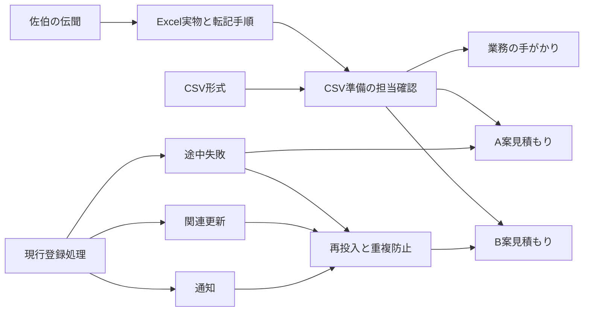

# 第3章「一括登録機能」実装仕様

<!-- document-status -->
> **ドロップ（次期設計として不採用）。** 旧実装の記録としてのみ残す。現在動いているゲームの由来を確認する資料で、次期設計の正本ではない。
> 現在の参照先は [00_README.md](00_README.md)。次期の業務背景は [background.md](background.md)、仕様は [10_第3章仕様.md](10_第3章仕様.md)、調査フローは [20_フロー.md](20_フロー.md)。
<!-- /document-status -->

[依頼仕様v2](report_drill_chapter3_codex-v2.md)を現行エンジンへ落とし込んだ仕様。編集の正本は [問題](../problems/03_bulk-import.md) と [会話](../scenarios/03_bulk-import.md)。JSONと `src/data/content.mjs` はビルド生成物。

## 台詞を起こす前提：毎朝の現場

取引先ごとに列順や書式が違うExcelが届く。登録担当は商品コード・商品名・数量・単価・納品予定日など約6項目を見ながら、全角・半角や日付を直し、単件登録画面へ転記している。通常20〜30件、月初50件程度。システムでは、その後に検証・関連更新・通知が動く。

| 人物・資料 | 情報の範囲 |
|---|---|
| 冒頭の佐伯 | 朝の入力が大変という伝聞。CSVという呼び方も曖昧 |
| 折原 | 10万円で受注したい。実装範囲の確認はまだ |
| `03.business` の佐伯 | 件数を数十〜百件と思っていたが、見てはいない。エラー時の手順も未確認 |
| `03.workbook` | 担当から届いた実物・回答により、20〜30件／月初50件と人手の補正が分かる。先の百件は伝聞の見込み違いとして回収 |
| `03.csv` | 登録側が受け取れる形式・入力チェックを確認。Excelの自動補正とは区別 |
| `03.csv-preparation` | 担当部署が列と表記を整え、所定CSVを用意することを確認 |
| 真壁 | マクロによる前処理の経験はある。今回の担当が実際に使う道具までは知らない |

ユーザーが修正した導入・伝聞の会話を維持する。調査では現物、動かした結果、人物の思い込みを順に出す。導入でA/Bや顧客判断を説明しない。完了の余韻は折原の10万円の話に戻し、学習内容の総括を挟まない。

## 目的と判定

技術的に分かる事実を揃えても、費用と業務の優先度は顧客が決める。方式を当てる問題にはしない。

| 報告に必要な事実 | 手がかり | 内容 |
|---|---|---|
| 業務の目的・運用 | `bi.business` | 担当部署がCSVの列・数字・日付を整える。置き換えるのは画面への転記・登録で、前処理は残る |
| A案 | `bi.a` | 全件取消、1日。導入が早く結果は単純。エラー修正後は全件を再投入 |
| B案 | `bi.b` | 正常行を残す、10日。正常行のやり直しを減らせるが、成功・失敗を分けた再投入運用が必要 |

この3枚の提示時に、主人公が両案の違いと工数、前処理が残ることを説明し、登録担当とも相談してもらう。顧客の採用決定は描かず、判断できる材料が揃った時点で完了する。真壁への相談・チャット閲覧・全チケットの消化を判定条件にしない。

`bi.business` は佐伯の伝聞だけでは手に入らない。伝聞の調査では `bi.hearsay`、実物の確認では `bi.workbook`、CSV準備の確認後に `bi.business` と見積もり範囲の `bi.csv-ready` を得る。両見積もりの解放にもCSV準備の確認を必要とする。

「対応案を書き出す」では未合意のA案採用・B案採用の提案カードを得られる。どちらかを選択した報告は独断の採用宣言になり、成功しない。事実の比較と自分の決定を区別するための寄り道で、必須ではない。

## 調査と時間

標準ルートは佐伯への確認30分→Excel実物20分→CSV形式25分→準備担当の確認15分→現行登録45分→途中失敗30分→関連更新30分→通知25分→再投入30分→A案見積もり25分→B案見積もり40分。調査計315分、昼休憩60分、Meets報告10分で15:25に完了できる。順番が固定なのは依存関係のみ。依頼再読、ライブラリ比較、大規模構成、他部署のテーブル、対応案の書き出しは任意。

B案10日は関連更新・通知・重複防止まで確認した確定見積もり。B案の工数を調べ続けるゲームにはしない。両案の1日／10日はこの案件固有の前提。

どちらも担当部署が所定CSVを用意する共通前提。取引先Excelの自動変換、表記揺れの自動補正、マクロの新規開発は含まない。形式不正を黙って登録することもしない。

CSV・実装資料の初回調査には情報がある。同じ作業の再実行には時間を使い、報酬は重複しない。再確認では「これ以上は調べても何も分からなそうだ。」を表示する。実行後も作業中に残し、完了は手動で移す既存ルールを維持する。

## 真壁の反応

既存の調査 `outcomes.when` で分岐し、新しい相談ボタンを追加しない。途中報告は全分岐30分で `progressReported: true`。初日の期限延長条件は変更しない。

| 優先順 | 条件 | 反応 |
|---|---|---|
| 1 | 障害・会議中 | 状況記録だけ受け取り、詳細な助言はしない |
| 2 | Excelの実物を調べ、マクロの話をまだ聞いていない | 書式揺れの話から、マクロで前処理する案が漏れる |
| 3 | 業務・A・Bを所持 | 両方持っていくという先輩自身の判断を話す |
| 4 | A・Bだけ所持 | 誰の話で進んでいるのかを問い返す |
| 5 | 途中失敗を調査済み | 過去の再投入・通知の失敗に触れる |
| 6 | それ以外 | まず現物を見るよう返す |

通常の「真壁に聞く」も予定と準備状況で反応する。未準備の質問は35分、準備済みは10〜15分。どちらの相談もクリアに必須ではない。

マクロ案は通常の相談なら15分、途中報告なら30分。両方で `bi.macro-heard` を共有し、同じ話を繰り返すことはない。`bi.macro` は提案カードで、既存マクロの存在や保守担当を確定させず、CSV準備の合意やA/Bの比較を代替しない。真壁に相談せずCSVの準備担当を確認する経路でもクリアできる。

## チャット未読（全章共通）

既存の時刻投稿とイベント終了後の履歴公開を維持する。投稿内容を読んで採点する処理はない。

- 投稿・履歴のキーを `state.chatRead.seen / unread` に保存し、件数だけで追跡しない。
- モバイルで閉じている場合と、表示中でも過去を読んでいる場合は新着を未読にする。雑談・持論・調査履歴に差を付けない。
- モバイル入口に件数バッジと一度きりの弱い強調を表示。常時点滅・音・ポップアップは使わない。
- チャットを開くと最初の未読にスクロールし「ここから未読」を表示。その時点で未読を解除する。末尾を表示している間の新着は既読扱い。
- 保存・再開では未読を維持する。既読情報のない従来セーブでは、初回の過去投稿を未読にしない。
- 動きを減らす設定・OS設定に従う。ヒントだけを強調しない。

## 実装箇所と互換性

ビルド対象に `03_bulk-import` を追加。ケースIDは `bulk-import`、保存キーは `report-drill.bulk-import.v1`。タイトルに3章を表示し、2章クリアから「3章へ」を用意する。章数は登録済みケースから求める。

既存の報告要素判定と `feedbackReactions` を使い、エンジンの新機能は追加しない。1・2章は変更しない。保存キー・内容バージョン・時計・延長・会話・チケット一覧・3枚報告UIは維持する。既存の3章セーブも調査を保ったまま、新しいExcel確認・CSV準備担当の確認を行える。旧 `bi.business` を所持していても準備確認のフラグがなければ新しい成功判定には進めない。

検証は `npm test`、`node scripts/build-content.mjs --check`、`node tests/browser.mjs`。第1・2章の回帰、3章の早期成功・独断失敗・再報告・延長・未読の保存再開を対象とする。
