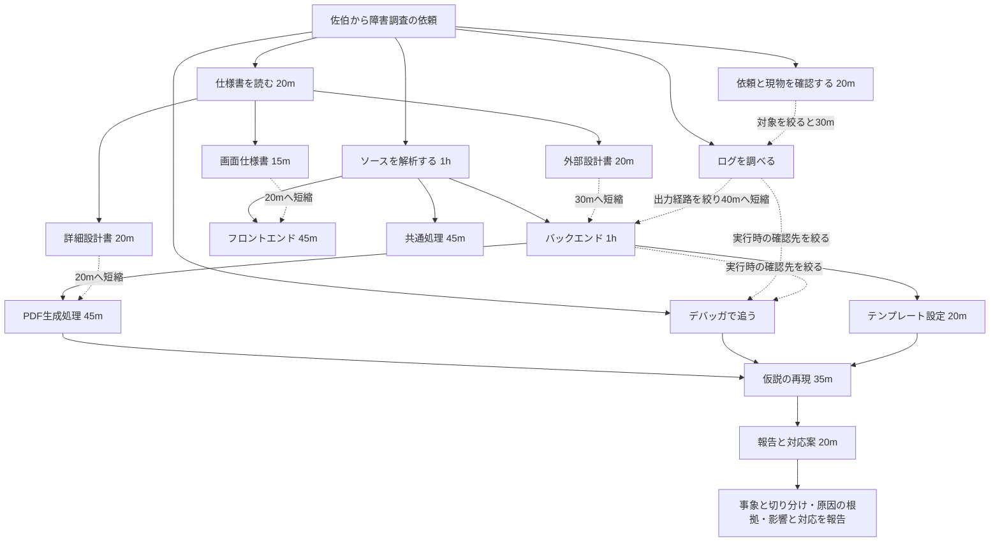

# 第1面：ウォーターマークの誤表示 ― 案件設計

経理の三田が取引先提出用に印刷したPDF資料に、田中太郎というウォーターマークが入る。田中は5年前に退職し、アカウントも無効化済み。三田が自分のアカウントで操作しているため、三田の氏名が透かしに入る想定。三田が提出前に気づいて問い合わせたところから、現物・出力ログ・実行時の値を照合し、この食い違いの原因を調べる。

人物・企業・障害・コードはすべて架空。田中は会話の話者にはしない。

## 障害と報告の軸

原因は、PDFの透かし用オプション `watermarkName` が空欄のときに入る「初期サンプル用の田中太郎」が現行処理にも残っていたこと。三田と別の利用者で出力・印刷しても、同じ氏名のウォーターマークになる。検証環境で参照先を認証済みの実行利用者に切り替えると、それぞれの氏名になる。

ウォーターマークの誤表示は裏付けられるが、別の帳票や印刷済み・提出済み資料の有無まで全件調査済みとはしない。「退職者のアカウントが今も使われている」「ほかの帳票はすべて問題ない」「誰々の設定ミスだ」と推測で報告しない。

自社の説明は「確認できた表示名設定の問題」「対象と確認範囲」「是正と再発防止案」を中心にする。真壁は角が立たない言い方を支えるが、未確認事項を隠したり責任を他人に押しつけたりはしない。

## カードの分岐

最初は現物確認、仕様書、ソース、ログ、デバッガ、AI、旧資料、真壁への質問という大きな入口だけを並べる。PDF生成処理のカードを初期表示しない。

再現には「PDFの現行ソース」「デバッガの値」「実際の設定」のすべてが必要。図の合流は、いずれか一つだけで解放するという意味ではない。

## 仕様書の効果

| 資料 | 得られる概要 | 対応するソースの時間 |
|---|---|---|
| 画面仕様書 | 画面はログイン利用者名、透かしは出力利用者の氏名 | フロントエンド45m → 20m |
| 外部設計書 | 出力APIと帳票サービスのつながり | バックエンド1h → 30m |
| 詳細設計書 | ウォーターマークの氏名オプションと引数 | PDF生成処理45m → 20m |

いずれも「最新化はされていないようだが、概要は分かった」という扱い。古い仕様書の情報は参考情報に分類し、原因の確定に必要な現行コード・実行時の値・再現結果の代用にしない。

ログで現物のリクエストを特定していれば、外部設計書なしでもバックエンドは40mになる。両方読んだ場合は30mを優先する。遠回りしなければ、全資料を読まなくても初日で解決できる。

短縮が発生したら、仕様書などの効果元から対象カードへ光の弾を飛ばし、着弾時に旧時間から新時間へカウントダウンしながら「−30m」などを表示する。カードが列内に隠れていれば見える位置へ移す。未解放の調査は名称を先出しせず短縮を通知し、解放時に演出する。動きを減らす設定では静止した短縮量を表示する。作業の完了で再調査時間がゼロになる変化は、読解時間の短縮とは区別して検出する。

## ログとデバッガは繰り返し使う

| 道具 | 準備なし | 当たりをつけた後 |
|---|---|---|
| ログ | 現物の識別がなく45m使っても対象を絞れない | 現物確認後、30mで三田の出力記録と照合 |
| デバッガ | 経路が分からず45m使っても値を確認できない | ログ照合またはバックエンド調査後、30mで三田の認証IDと透かしの氏名の食い違いを確認 |

どちらもイベント後に未着手へ戻す。次に使うときも時間は消費するが、同じ結果の知識・手がかりは重複して増えない。失敗時だけでなく、成功後も再び使える。

共通処理、旧リリース資料、先輩への準備不足の質問など、有用な効果が得られなかったカードも未着手へ戻す。フロントエンドの調査は原因そのものには届かなくても、画面の利用者情報は正しいという切り分け材料になる。

## 報告と根拠

| 問い | 選ぶ手がかり3枚 | 伝える内容 |
|---|---|---|
| 三田の印刷資料と、透かしの氏名の食い違い | 現物・退職記録・出力ログ | 三田の出力・印刷なのに、5年前に退職した田中太郎の透かしが入る |
| 透かしに誤った氏名が入る原因の裏付け | サンプル名補完コード・実行時の値・再現結果 | 未設定時の補完処理で、別利用者でも同じ透かしの誤表示が起きる |
| 三田と部署に説明する原因・影響・対応 | 補完コード・確認できた影響範囲・対応案 | 実行利用者の氏名を透かしに使うよう是正する。別帳票と印刷済み・提出済み資料への全件の影響は未確認 |

AIのキャッシュ説は一般論であり、今回の原因を示す根拠にはしない。本番修正は調査完了時点では未実施。対応案を報告したことと、本番で是正済みであることを混同しない。

## 期限と保存

途中報告があれば真壁が一日延長を調整し、翌日へ調査結果を引き継ぐ。報告なし、または延長日も未完了ならゲームオーバー。翌日の専用会話を使い、夢や初日の依頼を重複再生しない。

第1面を機能追加の調査から障害調査に変更したため、原稿の版は2。保存キーは `report-drill.pdf-incident.v1` に分離し、以前の機能追加シナリオの保存は上書きしない。
